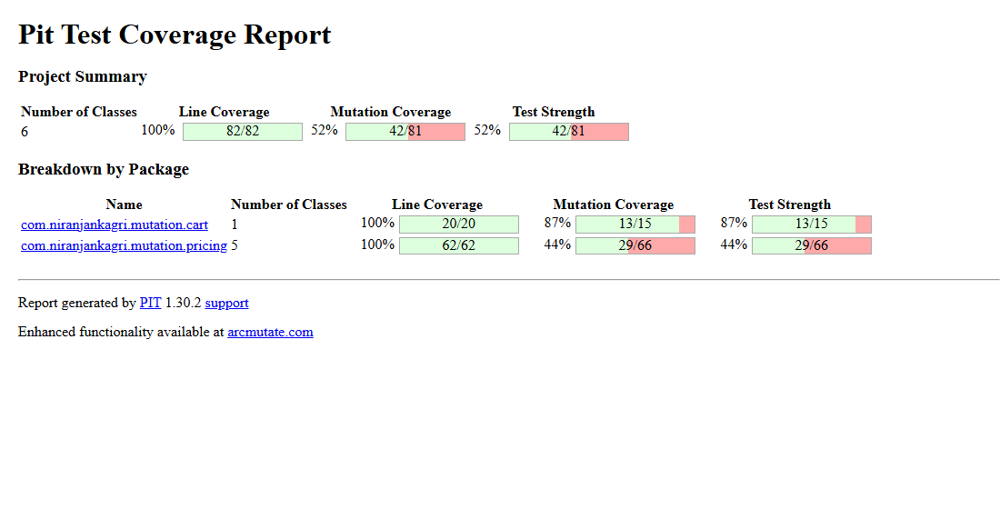
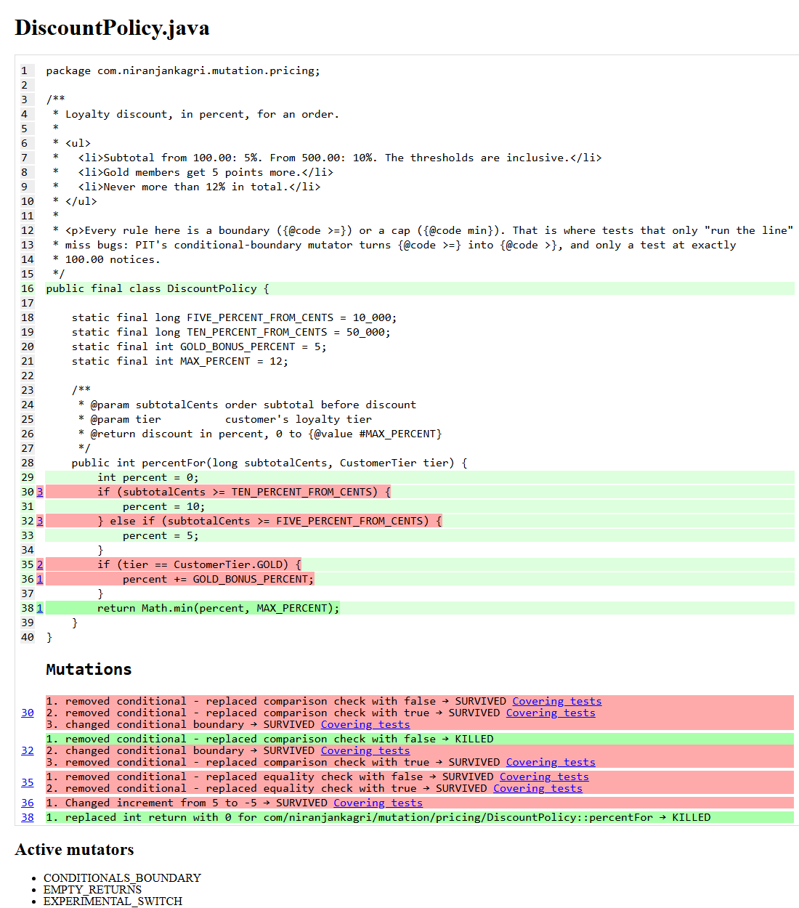
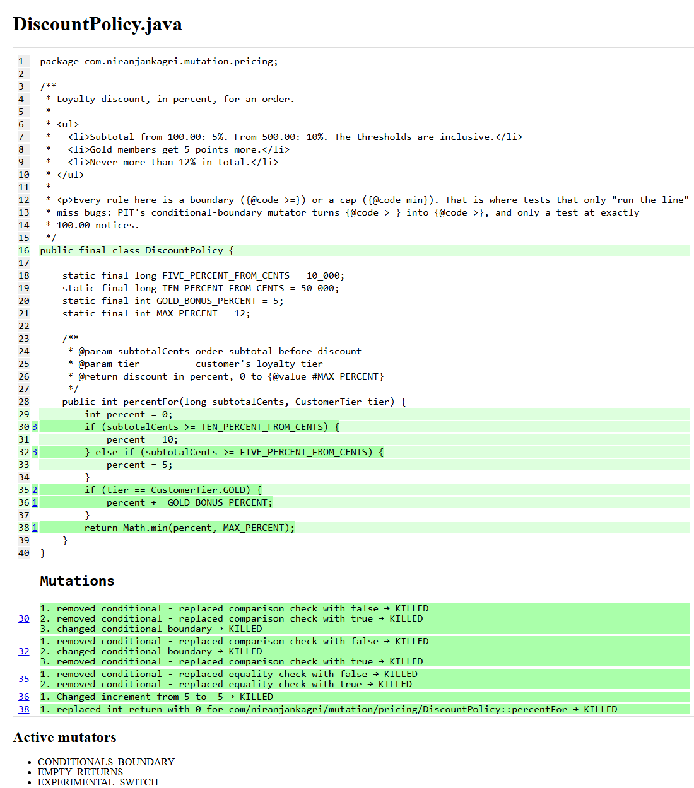

# PIT mutation testing

Two test suites for the same Java code. Both run **every line** (100% line coverage in JaCoCo), but one of them would
let 39 bugs through. [PIT](https://pitest.org) finds them by making small changes (mutants) to the production code
and checking whether any test fails.

| Suite | Tests | Line coverage (JaCoCo) | Mutants | Killed | Survived | Mutation score |
|---|---:|---:|---:|---:|---:|---:|
| `weak` | 15 | **100%** (91/91) | 81 | 42 | 39 | **52%** |
| `strong` | 40 | **100%** (91/91) | 81 | 81 | 0 | **100%** |

Real run: PIT 1.30.2, `STRONGER` mutators, JUnit 6.1.3, Java 21. About 50 seconds per suite locally.
CI runs both suites and fails the build if the strong suite lets a single mutant survive.

## Same coverage, different tests

PIT's report for the weak suite: every line green, yet half the mutants survive.



`DiscountPolicy` under the weak suite: all lines run (light green), but the discount thresholds (red) can be changed
without any test noticing.



The same class under the strong suite: every mutant killed.



## What the weak suite lets through

Each surviving mutant is a bug that could ship with all tests green. The 39 survivors, grouped by what the bug
would be (CI lists them all in the job summary):

| Bug that would ship | Mutant (line) | Why the weak test misses it | What the strong test does |
|---|---|---|---|
| Discount starts at 100.01 instead of 100.00 | `>=` became `>` (`DiscountPolicy` 30, 32) | Tests 200.00 and 600.00, never the threshold | Rows at 99.99, 100.00, 499.99, 500.00 |
| **Every customer gets the Gold bonus** | `tier == GOLD` replaced with `true` (35) | Asserts "discount is positive" | Same subtotal, both tiers, exact percent |
| Gold bonus subtracts 5 instead of adding | `+= 5` became `+= -5` (36) | 10 - 5 is still positive | Exact percent |
| Free shipping from 50.01 | `>=` became `>` (`ShippingCalculator` 31) | Tests 20.00 and 80.00 | 49.99 pays, 50.00 is free |
| Wrong fee per kilogram, wrong rounding of kilograms | `-` / `*` / `/` swapped (34, 43) | Only checks the fee is positive | 1 g, 1,000 g, 1,001 g, 2,000 g, 2,001 g with exact fees |
| Express costs half, or the same as standard; standard costs double | `* 2` became `/ 2`; the speed check forced to `true` or `false` (35, 36) | "Express costs something" | Exact fees for both speeds: 4.99 standard, 9.98 express |
| A 1 g parcel is refused | `<` became `<=` (`ShippingCalculator` 28) | Tests 0 g only | Prices a 1 g parcel |
| Refused coupon returns `null` | return value replaced with `null` (`CouponValidator` 25-34) | `isNotEqualTo(ACCEPTED)` is also true for `null` | Asserts the exact reason |
| A coupon is refused at exactly its minimum | `<` became `<=` (33) | Tests 10.00 against a 30.00 minimum | 29.99 is refused, 30.00 accepted |
| **An expired coupon still gives its discount** | filter result replaced with `true` (`OrderPricer` 50) | Only prices a valid coupon | Prices with an expired coupon, expects no discount |
| **A coupon can be used again and again** | call to `markUsed` removed (57) | Checks `couponUsed()` on the receipt only | Checks the validator now says `ALREADY_USED` |
| An equal coupon is used up | `>` became `>=` (53) | No test where coupon = loyalty | 5% coupon vs 5% loyalty stays unused |
| Discount added instead of subtracted; tax rounding flipped | `-`/`+`/`*` swapped (61, 64, 69) | "Total is positive", "tax is positive" | Whole receipts worked out by hand; 33.33 and 0.02 for rounding |
| A 0.00 gift is refused | `<` became `<=` (`Cart` 27) | Tests -1 only | Adds a free gift |
| Subtotal divides instead of multiplying | `*` became `/` (`Cart` 41) | "Subtotal is positive" | Exact subtotal of two lines |

## What makes a test kill mutants

All of these are in [`src/test/java/.../strong`](src/test/java/com/niranjankagri/mutation/strong):

- **Test both sides of every boundary, one unit apart.** 99.99 / 100.00, 49.99 / 50.00, 1,000 g / 1,001 g, the day
  before / the first day. A value in the middle of a range never notices `>=` becoming `>`.
- **Assert exact values, not "positive" or "not null".** Exact amounts kill the arithmetic mutants (`+` to `-`,
  `*` to `/`); exact enum values kill "return null".
- **Check side effects, not only return values.** The receipt said `couponUsed = true` even with `markUsed()`
  removed; only asking the validator afterwards catches it.
- **Cover the cases where a rule should not apply.** An expired coupon, an equal coupon, a standard customer next to
  a gold one.
- **Work expected values out by hand.** `OrderPricerTest` writes each receipt's arithmetic in a comment, so a reviewer
  can check the expectation without running the code.

## DEFAULTS vs STRONGER mutators

PIT's mutator group is a property (`-Dmutators=`). Measured on this code:

| Mutator group | Mutants | Weak suite | Strong suite |
|---|---:|---:|---:|
| `DEFAULTS` | 63 | 48% (33 survive) | 100% |
| `STRONGER` (used here) | 81 | 52% (39 survive) | 100% |

`STRONGER` adds "remove conditional" mutants. It found 6 more weaknesses in the weak suite that `DEFAULTS` did not,
including "every customer gets the Gold bonus" and "every parcel is charged the express price".

## Design

| Pattern | Where |
|---|---|
| Two suites, one code base | `strong/` and `weak/` test the same classes; `-Dsuite=` picks which one Surefire, JaCoCo and PIT use |
| Test data builders | `testdata/CartBuilder` (`aCart().worth("100.00")`), `CouponBuilder` (valid all November unless changed) |
| Readable amounts | `Amounts.cents("99.99")` instead of `9_999`, so a boundary is visibly one cent away |
| Fixture object | `testdata/PricingFixture` wires the real collaborators; no mocks, because a mock would hide the arithmetic PIT mutates |
| Parameterized boundary tables | `DiscountPolicyTest`, `ShippingCalculatorTest`: one `@CsvSource` row per edge |
| Money as whole cents (`long`) | PIT's math mutators flip `+`, `-`, `*`, `/` on primitives; with `BigDecimal` they could only remove method calls |

## Run it

Needs Java 21+.

```bash
./mvnw verify                                        # strong suite: tests, JaCoCo, PIT; fails below 100%
./mvnw verify -Dsuite=weak -Dmutation.threshold=0    # weak suite, report only
./mvnw verify -Dsuite=weak                           # see the threshold fail: "Mutation score of 52 is below threshold of 100"
./mvnw verify -Dmutators=DEFAULTS                    # compare mutator groups
python3 scripts/pit_summary.py strong                # the Markdown summary CI writes
```

Reports: `target/pit-reports/index.html` (mutants) and `target/site/jacoco/index.html` (line coverage).

## Gotchas found while building it

| Problem | Fix |
|---|---|
| `-Dpit.mutators=DEFAULTS` had no effect | A value set in the POM's `<configuration>` wins over the command line. The group is now the `${mutators}` property |
| PIT says 82/82 lines, JaCoCo 91/91 | The two tools count lines differently; both say 100%. The README quotes JaCoCo |
| Will PIT find JUnit 6 tests? | Yes, with `pitest-junit5-plugin` 1.2.3 as a plugin dependency of `pitest-maven` (checked on this build) |
| A new report folder per run | `timestampedReports=false`, so CI and the summary script always read `target/pit-reports/` |

## Project layout

```
src/main/java/.../cart        Cart, CartLine
src/main/java/.../pricing     DiscountPolicy, ShippingCalculator, CouponValidator, OrderPricer and their types
src/test/java/.../strong      40 tests: boundaries, exact values, side effects
src/test/java/.../weak        15 tests: same lines covered, weak assertions (kept on purpose)
src/test/java/.../testdata    Amounts, CartBuilder, CouponBuilder, PricingFixture
scripts/pit_summary.py        Coverage + mutation summary in Markdown (CI job summary)
docs/images                   PIT report screenshots (headless Chrome)
```

## License

MIT
